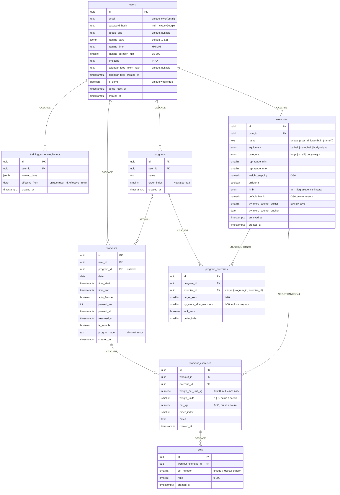
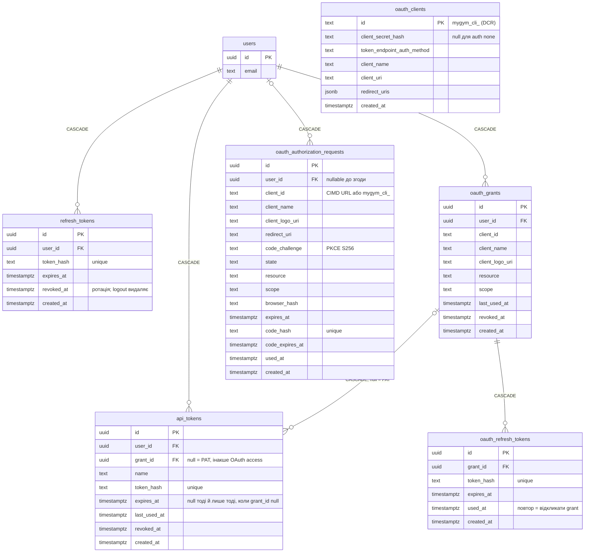

# Архітектура бази даних MyGym

PostgreSQL 16. Схему описує `backend/src/db/schema.ts` (Drizzle ORM), міграції
лежать у `backend/migrations/` (drizzle-kit). Поруч є `schema.sql`: це
`pg_dump --schema-only` реальної dev-БД, тобто те, що фактично створено в
Postgres, без абстракцій Drizzle.

## Загальна картина

Підписи на зв'язках — що стається з рядком, коли видаляють батьківський (деталі — «Поведінка при видаленні»). `|o` — зв'язок необов'язковий: тренування без програми, `api_tokens` без grant-а (тобто PAT).

### Тренування



### Автентифікація, PAT, OAuth

`users` тут лише з `id` і `email`, щоб не дублювати поля з діаграми вище.



`oauth_clients` навмисно без FK: grant і запит на згоду тримають `client_id` текстом, бо це або CIMD-URL (Claude, ChatGPT), або `mygym_cli_…` з DCR.

Схема має три шари:

1. **Користувач і доступ:** `users`, `refresh_tokens`, `training_schedule_history`,
   а також токени для програм — `api_tokens` (PAT і OAuth access) та OAuth для
   MCP-клієнтів: `oauth_authorization_requests`, `oauth_grants`,
   `oauth_refresh_tokens`, `oauth_clients`.
2. **Довідники користувача:** `exercises` (що він уміє робити) і `programs` +
   `program_exercises` (заплановані набори вправ).
3. **Факти тренувань:** `workouts` → `workout_exercises` → `sets`. Це ієрархія
   «тренування → вправа в ньому → підходи».

Майже кожна таблиця тягнеться до `users.id`, прямо або ланцюжком. Це
**multi-tenant в одній схемі**: дані різних користувачів розділяє `user_id`,
а не окремі схеми чи БД. Тому кожен запит бекенду фільтрує за `user_id`.
Таблиці нижче за ієрархією (`sets`, `workout_exercises`, `program_exercises`)
власного `user_id` не мають, і належність перевіряється через JOIN на батька.

## Таблиці

### `users`
| Колонка | Тип | Примітка |
|---|---|---|
| `id` | uuid PK | `gen_random_uuid()` |
| `email` | text | унікальний **без урахування регістру**: індекс на `lower(email)`, а не на саму колонку |
| `password_hash` | text, nullable | argon2, пароль у відкритому вигляді ніде не зберігається. `null` — акаунт створено через Google |
| `google_sub` | text, nullable, unique | Google ID (`sub`), якщо акаунт прив'язаний до Google |
| `training_days` | jsonb | масив ISO-днів (1=Пн…7=Нд), за замовчуванням `[1,3,5]`. Це **поточний** розклад |
| `training_time` | text | `HH:MM`, за замовчуванням `18:00` — початок тренування для календарного фіда |
| `training_duration_min` | smallint | тривалість події у фіді, за замовчуванням 60 |
| `timezone` | text | IANA-пояс (`Europe/Kyiv` за замовчуванням), у якому `training_time` — локальний час |
| `is_demo` | boolean | спільний демо-акаунт (`POST /api/auth/demo`). Частковий unique-індекс `users_demo_idx` (`WHERE is_demo`) — не більше одного (міграція 0025) |
| `demo_reset_at` | timestamptz, nullable | коли демо востаннє перекопійовано з акаунта-шаблону (`TEMPLATE_ACCOUNT_EMAIL`); через добу копіюється знову |
| `calendar_feed_token_hash` | text, nullable, unique | SHA-256 секретного токена календарного фіда; `null` — календар не підключено |
| `calendar_feed_created_at` | timestamptz, nullable | коли фід підключено / перегенеровано |
| `created_at` | timestamptz | |

Час, тривалість і пояс у `training_schedule_history` **не** дублюються: історія
лише про дні, а всі серії календарного фіда беруть поточний час. Пояс — IANA, а не
зсув UTC, щоб повторювані події не з'їжджали на годину при переході на літній/зимовий час.

Чому `training_days` у jsonb, а не в окремій таблиці: це маленький масив, який
завжди читається й пишеться цілком. Окрема таблиця `user_training_days` дала б
лише зайві JOIN. Обмін: Postgres не перевіряє, що там справді числа 1–7, і
валідацію бере на себе Zod у бекенді.

### `refresh_tokens`
Зберігається **хеш** refresh-токена, а не сам токен: витік БД не дає готових
токенів. `revoked_at` ставиться при ротації. Протягом 60 с grace-вікна
щойно відкликаний токен ще приймається. Logout рядок **видаляє**, щоб grace
не працював після виходу (деталі в `CLAUDE.md`, розділ «Auth»).

### `training_schedule_history`
Знімок розкладу на кожен день, коли він змінювався. Для дати D діє розклад із
рядка з найбільшим `effective_from <= D`. Це патерн **slowly changing
dimension (type 2)**: замість перезапису історії додаємо нову версію з датою
початку дії. Унікальність `(user_id, effective_from)` означає, що кілька змін
за один день перезаписують один рядок (upsert).

`users.training_days` і остання версія з цієї таблиці дублюють одне одне.
Свідома денормалізація: поточний розклад читається часто й без пошуку «останнього
рядка».

### `exercises`
Особистий список вправ (при реєстрації сідиться 13 стандартних). Тут живуть
правила прогресії для вправи:

- `category` (`large`/`small`/`bodyweight`) визначає логіку підказок;
- `rep_range_min`/`rep_range_max` задають діапазон повторень (6–15 / 6–20 / 6–30);
- `weight_step_kg` — крок ваги **на одну сторону/гантель** (1.25 / 0.5).

`equipment` описує інвентар (`barbell`/`dumbbell`/`bodyweight`) і від категорії
не залежить. Приклад: «Жим стоячи» — штанга, але категорія `small` через травму плеча.

Модель навантаження (міграція 0026, розрахунки — `progression/load.ts`):
- `unilateral` — ліва і права працюють по черзі (випади, французький жим однією
  гантеллю): повторення пишуться **на одну сторону**, обсяг рахує обидві;
  `limb` (`arm`/`leg`) лише підписує повторення, є тільки з `unilateral`.
- `default_bar_kg` — гриф, з яким стартує нове тренування (лише `barbell`,
  default 20; у тренування копіюється як `workout_exercises.bar_kg`).

`archived_at` реалізує soft-delete: вправу, на яку вже посилаються тренування,
не можна видалити фізично (див. FK нижче), тому її ховають.

### `programs` і `program_exercises`
Програма — іменований шаблон («Програма А»), який створюють заздалегідь.

- `programs.order_index` задає чергу ротації A→Б→A…
- `program_exercises.try_more_after_workouts` (nullable) — «N тренувань цієї
  вправи без прогресу» до нагадування `try_more`. `null` залишає стандарт за
  категорією вправи (4 / 6 / 5 — `DEFAULT_TRY_MORE_AFTER_WORKOUTS`); вправа в
  кількох програмах — найменший. Порогу на всю програму нема (до міграції 0028
  був `programs.try_more_after_workouts`; видалено без переносу у вправи —
  рішення користувача 2026-10-31).
- `program_exercises` зберігає лише **яку** вправу, **скільки** підходів
  (`target_sets`) і **в якому порядку**. Ваги тут свідомо немає: при старті
  тренування вона береться з останнього фактичного виконання вправи, а не зі
  «стартового» значення, яке швидко застаріває.

### `workouts`
Одне тренування. `time_start`/`time_end` бекенд ставить сам: `time_end` — кнопкою
«Завершити» або автоматично через 1,5 год без змін (`auto_finished = true`,
`time_end` = момент останнього збереження; див. CLAUDE.md, «Автозавершення»).

Пауза таймера в хедері (міграція 0024): `paused_ms` — сума закритих пауз,
`paused_at` — початок поточної (`null` — таймер іде), `resumed_at` — останнє
зняття паузи. Тривалість = `time_end − time_start − paused_ms`. «Завершити» й
автозавершення згортають відкриту паузу в `paused_ms`; пауза й зняття паузи для
автозавершення — теж активність.

`is_sample` (міграція 0025) — приклад, скопійований з акаунта-шаблону в новий
акаунт при реєстрації (4 останні тренування шаблону, дати зсунуті на цілі
тижні). «Прибрати приклади» (`DELETE /api/workouts/samples`) видаляє всі разом
і повертає початок `training_schedule_history` на день реєстрації.

Є два способи позначити, «що це було за тренування»:

| Поле | Що це | Навіщо |
|---|---|---|
| `program_label` | вільний текст («А», «Б») | старий механізм шаблонів: «повтори вправи з останнього тренування з тією самою міткою» |
| `program_id` | FK на `programs`, nullable | новий механізм: з якої саме програми стартувало тренування, для ротації |

Обидва поля співіснують заради сумісності зі старими даними, бо `program_label`
з'явився раніше за програми. Під час старту з програми її назва
записується і в `program_label`.

### `workout_exercises`
Вправа в межах конкретного тренування. Головне рішення моделі: **вага
зберігається тут, а не в підході**, бо в межах вправи вона не змінюється
(підтверджено). Це прибирає дублювання ваги в кожному підході й робить
неможливим стан «різна вага в підходах».

- `weight_per_unit_kg` — за `exercises.equipment`: штанга — диски на **одну**
  сторону (без грифа, як у CSV-таблиці: `2*20`); гантелі — **одна** гантель;
  власна вага — обтяження.
- `weight_units` — гантелі: скільки гантелей рухається в **одному** повторенні
  (1 або 2, не скільки тримаєш у руках); штанга — завжди 2 (сторони). Default у
  БД немає (з міграції 0021): бекенд завжди пише його явно, а без ваги — `null`.
- `bar_kg` — гриф, з яким зроблено вправу (лише штанга, лише з вагою): знімок
  `exercises.default_bar_kg`, тож зміна дефолту історію не переписує. Міграція
  0026 проставила наявній історії штанги 20 кг і `weight_units = 2`.
- Вага в повторенні: штанга = `bar_kg + 2 × weight_per_unit_kg`, гантелі =
  `weight_units × weight_per_unit_kg`, власна вага = `weight_per_unit_kg`.
  Обсяг = вага в повторенні × сума повторень (× 2 для `unilateral`).
- `weight_per_unit_kg IS NULL` означає безвагову вправу.

### `sets`
Найпростіша таблиця: номер підходу й кількість повторень. Унікальність
`(workout_exercise_id, set_number)` не дає двох «других підходів» в одній
вправі. Це страховка від дублювання при автозбереженні.

## Поведінка при видаленні (FK)

| Зв'язок | ON DELETE | Наслідок |
|---|---|---|
| `users` → усі дочірні | **CASCADE** | видалення користувача прибирає всі його дані |
| `workouts` → `workout_exercises` → `sets` | **CASCADE** | видалив тренування — зникли й вправи з підходами |
| `programs` → `program_exercises` | **CASCADE** | склад програми видаляється разом з нею |
| `programs` → `workouts.program_id` | **SET NULL** | тренування лишаються, губиться тільки зв'язок із програмою |
| `exercises` ← `workout_exercises`, `program_exercises` | **NO ACTION, DEFERRABLE INITIALLY DEFERRED** | вправу з історією видалити не можна, лише архівувати |

Цей FK захищає історію: видалення вправи інакше або знищило б усі минулі
підходи (CASCADE), або залишило б підходи «нічиєї» вправи (SET NULL).

Чому відкладений, а не RESTRICT (міграція 0019): видалення користувача каскадить і
в `exercises`, і в `workouts`. RESTRICT перевіряється одразу й падав раніше, ніж
каскад через `workouts` прибирав `workout_exercises`, — користувача з тренуваннями
не можна було видалити. `NO ACTION` без `DEFERRABLE` падає так само. З перевіркою
на коміті видалення користувача проходить, а пряме видалення вправи, що є в
історії чи програмі, — так само помилка `23503`. Drizzle не вміє `DEFERRABLE`, тому
його дописано в міграцію вручну.

## Обмеження (CHECK і UNIQUE, міграції 0021–0022)

Межі значень дублюють Zod-схеми API, щоб некоректні дані не потрапили в БД і
повз API (ручний SQL, майбутній код, MCP). Перевірено на проді перед міграцією:
порушень 0, дублікатів назв 0.

| Обмеження | Правило |
|---|---|
| `users_training_duration_min_check` | 15…300 хв |
| `api_tokens_kind_check` | `grant_id` і `expires_at` або обидва є (OAuth-токен), або обох нема (PAT) |
| `exercises_user_name_idx` UNIQUE | `(user_id, lower(btrim(name)))` — **разом з архівними** |
| `exercises_rep_range_check` | `1 ≤ min ≤ max ≤ 100` |
| `exercises_weight_step_check` | 0…50 кг |
| `exercises_default_bar_check` | `default_bar_kg` 0…50 кг і **лише для штанги** (міграція 0026) |
| `exercises_limb_check` | `limb` лише з `unilateral` (міграція 0026) |
| `program_exercises_try_more_check` | 1…60 (або `null`) |
| `program_exercises_program_exercise_idx` UNIQUE | одна вправа — один раз у програмі |
| `program_exercises_target_sets_check` | 1…20 |
| `workout_exercises_weight_check` | 0…500 кг |
| `workout_exercises_weight_units_check` | `units` — `null` або 1/2 **лише з вагою**; вага без `units` дозволена (старі рядки, читачі беруть 2) |
| `workout_exercises_bar_check` | `bar_kg` 0…50 кг (міграція 0026) |
| `sets_reps_check`, `sets_set_number_check` | повторення 0…200, номер підходу ≥ 1 |
| `workouts_paused_ms_check` | `paused_ms ≥ 0` (міграція 0024) |
| `workouts_paused_open_check` | у завершеного тренування нема відкритої паузи: `paused_at` або `time_end` — `null` (міграція 0024) |

Унікальна назва вправи разом з архівними: інакше `UNIQUE` довелося б робити
частковим (`WHERE archived_at IS NULL`), і після архівування з'являлися б дві
однойменні вправи з окремими історіями. Тому створення вправи з назвою
архівної **відновлює** ту саму вправу (той самий id, нові параметри,
`archived_at = null`) разом з історією; назва активної → 409
`exercise_name_taken`. Бекенд ловить `23505` (`utils/pgErrors.ts`) і на гонці
двох створень.

## Індекси

| Індекс | Під який запит |
|---|---|
| `users_email_idx` UNIQUE on `lower(email)` | логін, перевірка email при реєстрації |
| `workouts_user_date_idx` `(user_id, date)` | журнал з пагінацією, календар консистентності, `/workouts/dates?from&to` |
| `workouts_user_label_idx` `(user_id, program_label)` | `GET /workouts/templates`: останнє тренування на кожну мітку |
| `workout_exercises_exercise_idx` | історія й графік прогресу однієї вправи, «останнє виконання вправи» |
| `workout_exercises_workout_idx`, `sets_workout_exercise_idx`, `program_exercises_program_idx` | завантаження дочірніх рядків |
| `program_exercises_exercise_idx` | у яких програмах вправа (поріг `try_more`), перевірка FK при видаленні вправи |
| `*_user_idx` | списки «все моє» (вправи, програми, токени, історія розкладу) |

Postgres **не створює** індекси на FK-колонках автоматично (на відміну від
MySQL/InnoDB), тому вони прописані явно в `schema.ts`.

## Типи даних: чому саме такі

- **uuid** замість serial для PK: id не розкривають кількість записів і не
  вгадуються перебором (`/workouts/1`, `/workouts/2`…). Бекенд перевіряє
  формат UUID у path-параметрах ще до запиту в БД.
- **numeric** для ваги, а не float: 1.25 + 1.25 має давати рівно 2.50, без
  `2.4999999`. Drizzle повертає numeric як **рядок**, тому бекенд перетворює
  його на число вручну.
- **smallint** для повторень, підходів і порядку: значення гарантовано малі.
- **date** для `workouts.date` і **timestamptz** для моментів часу: дата
  тренування — календарний день без часового поясу, а `time_start`/`created_at`
  — точні моменти.
- **pgEnum** для `equipment` і `category`: набір значень фіксований і
  впливає на логіку. Мітка програми, навпаки, звичайний text, бо назви вигадує
  користувач.

## Службова схема `drizzle`

`drizzle.__drizzle_migrations` — журнал застосованих міграцій (хеш + час).
drizzle-kit за ним визначає, які файли з `backend/migrations/` ще не накочені.
Руками не редагувати.

## Як звідси читати дані: приклад

Історія ваги і повторень по одній вправі (по суті, що бачить графік прогресу):

```sql
SELECT w.date,
       coalesce(we.bar_kg, 0) + 2 * we.weight_per_unit_kg AS load_per_rep_kg,  -- штанга
       max(s.reps)                                          AS max_reps,
       (coalesce(we.bar_kg, 0) + 2 * we.weight_per_unit_kg) * sum(s.reps) AS volume_kg
FROM workouts w
JOIN workout_exercises we ON we.workout_id = w.id
JOIN exercises e          ON e.id = we.exercise_id
JOIN sets s               ON s.workout_exercise_id = we.id
WHERE w.user_id = :user_id AND e.name = 'Присідання'
GROUP BY w.date, we.id
ORDER BY w.date;
```

## Файли дампу

| Файл | Що всередині | Git |
|---|---|---|
| `docs/db/schema.sql` | лише структура (`--schema-only`) | безпечно комітити |
| `backups/mygym_full_<дата>.sql` | структура + дані, текстовий SQL | **ні**: `backups/` у `.gitignore`, там хеш пароля й refresh-токени |
| `backups/mygym_full_<дата>.dump` | те саме в custom-форматі (`-Fc`) | **ні** |

Перезняти дамп (dev-стек має бути запущений):

```bash
docker compose -f docker-compose.dev.yml exec -T postgres \
  pg_dump -U mygym -d mygym --schema-only --no-owner --no-privileges > docs/db/schema.sql
```

Відновити повний дамп у **порожню** БД:

```bash
# custom-формат
docker compose -f docker-compose.dev.yml exec -T postgres \
  pg_restore -U mygym -d mygym --clean --if-exists --no-owner < backups/mygym_full_<дата>.dump
```
